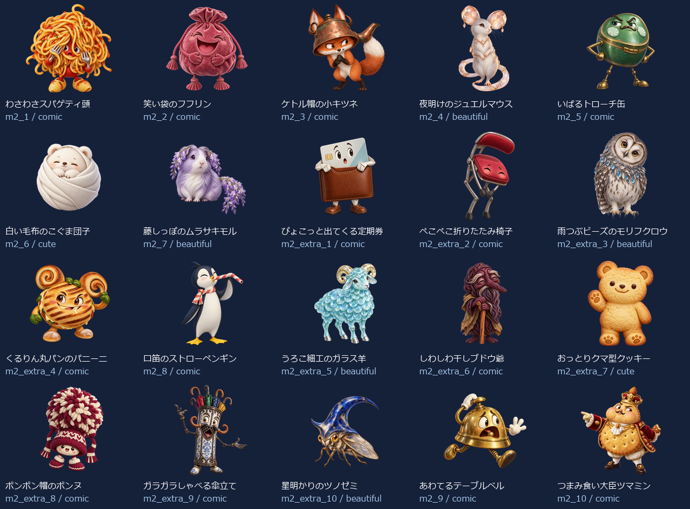
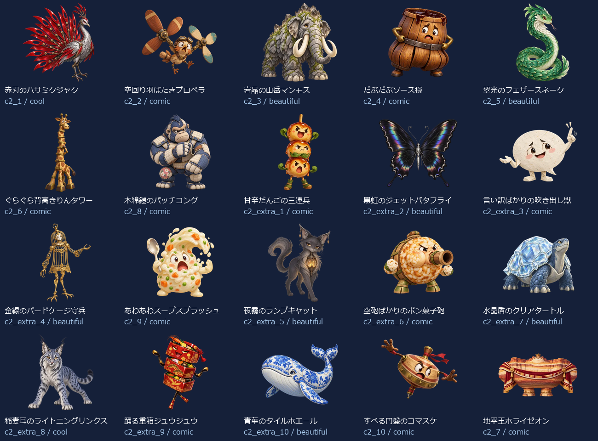
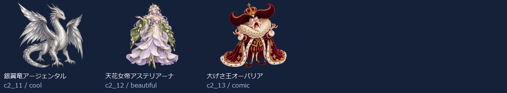

# Eiken1Part1 Level 2：新名称・新画像43体（2026-10-14）

- 練習20＋バトル23（裏ボス3を含む）＝43キャラ。出題方法で倍に数えていません。
- 新しい名称に合わせてbuilt-in image_genで各キャラを個別制作。以前の4級以降の画像を改名して使っていません。
- 同じprofileから級＋既存IDで名前・タイプ・色・台詞・画像を取得。図鑑・トップ・戦闘・勝利・拡大へ反映。
- 既存ID・HP・登場順・撃破保存キーを維持。5級の名簿と画像は維持。
- 目・表情・体形・素材・画風を分散。設計方向はコミカル25体・かっこいい3体・かわいい2体・きれい13体。分類の件数は笑えることの保証ではなく、実際の見た印象を一覧で確認します。

## 画像と読み込み

- 256px：43枚合計738.0KiB、平均17.2KiB。
- 384px：43枚合計1323.2KiB、平均30.8KiB。
- 1024px：43枚合計6779.8KiB、平均157.7KiB。
- 静止透過WebP、元画像を拡大せず変換。図鑑は遅延取得、戦闘は次の敵の通常画像だけ先読み、高解像度は拡大表示または登場・撃破する現在の1体だけ取得。追加ライブラリなし。
- 旧画像を保全する別URLフォルダを使用し、古い画像キャッシュとの混同を防止。

## 修正一覧

| 区域・順 | ID | 旧名称 | 新名称 | デザインの方向 |
| --- | --- | --- | --- | --- |
| 練習 1 | m2_1 | 遅刻コウモリ | わさわさスパゲティ頭 | コミカル |
| 練習 2 | m2_2 | わすれんぼウルフ | 笑い袋のフフリン | コミカル |
| 練習 3 | m2_3 | いじわるフォックス | ケトル帽の小キツネ | コミカル |
| 練習 4 | m2_4 | 居眠りベア | 夜明けのジュエルマウス | きれい |
| 練習 5 | m2_5 | 黒板消しクリーチャー | いばるトローチ缶 | コミカル |
| 練習 6 | m2_6 | リコーダーへび | 白い毛布のこぐま団子 | かわいい |
| 練習 7 | m2_7 | ドッジボールゴーレム | 藤しっぽのムラサキモル | きれい |
| 練習 8 | m2_extra_1 | 朝礼コウモリ | ぴょこっと出てくる定期券 | コミカル |
| 練習 9 | m2_extra_2 | 忘れ物チェックウルフ | ぺこぺこ折りたたみ椅子 | コミカル |
| 練習 10 | m2_extra_3 | 仲直りフォックス | 雨つぶビーズのモリフクロウ | きれい |
| 練習 11 | m2_extra_4 | 目覚ましベア | くるりん丸パンのパニーニ | コミカル |
| 練習 12 | m2_8 | うわばき隠し | 口笛のストローペンギン | コミカル |
| 練習 13 | m2_extra_5 | 黒板みがき精 | うろこ細工のガラス羊 | きれい |
| 練習 14 | m2_extra_6 | 音階へび | しわしわ干しブドウ爺 | コミカル |
| 練習 15 | m2_extra_7 | キャッチ練習ロボ | おっとりクマ型クッキー | かわいい |
| 練習 16 | m2_extra_8 | 上ばき番人 | ボンボン帽のボンヌ | コミカル |
| 練習 17 | m2_extra_9 | 静けさトロール | ガラガラしゃべる傘立て | コミカル |
| 練習 18 | m2_extra_10 | テスト前スピリット | 星明かりのツノゼミ | きれい |
| 練習 19 | m2_9 | 騒音トロール | あわてるテーブルベル | コミカル |
| 練習 20 | m2_10 | テストの悪魔 | つまみ食い大臣ツマミン | コミカル |
| バトル 1 | c2_1 | ポイズンスライム | 赤刃のハサミクジャク | かっこいい |
| バトル 2 | c2_2 | 氷結のオオカミ | 空回り羽ばたきプロペラ | コミカル |
| バトル 3 | c2_3 | サンダーバード | 岩晶の山岳マンモス | きれい |
| バトル 4 | c2_4 | ファントムナイト | だぶだぶソース樽 | コミカル |
| バトル 5 | c2_5 | 古代兵器オメガ | 翠光のフェザースネーク | きれい |
| バトル 6 | c2_6 | デス・スコーピオン | ぐらぐら背高きりんタワー | コミカル |
| バトル 7 | c2_8 | ブリザードミラー | 木綿鎧のパッチコング | コミカル |
| バトル 8 | c2_extra_1 | 毒霧スライム | 甘辛だんごの三連兵 | コミカル |
| バトル 9 | c2_extra_2 | 氷牙ウルフ | 黒虹のジェットバタフライ | きれい |
| バトル 10 | c2_extra_3 | 雷羽バード | 言い訳ばかりの吹き出し獣 | コミカル |
| バトル 11 | c2_extra_4 | 幻影ナイト | 金線のバードケージ守兵 | きれい |
| バトル 12 | c2_9 | ナイトメアクロウ | あわあわスープスプラッシュ | コミカル |
| バトル 13 | c2_extra_5 | 古代ギア兵 | 夜霧のランプキャット | きれい |
| バトル 14 | c2_extra_6 | 砂毒スコーピオン | 空砲ばかりのポン菓子砲 | コミカル |
| バトル 15 | c2_extra_7 | 氷鏡の番人 | 水晶盾のクリアタートル | きれい |
| バトル 16 | c2_extra_8 | 悪夢の羽音 | 稲妻耳のライトニングリンクス | かっこいい |
| バトル 17 | c2_extra_9 | 深海の審判官 | 踊る重箱ジュウジュウ | コミカル |
| バトル 18 | c2_extra_10 | 冥府の門衛 | 青華のタイルホエール | きれい |
| バトル 19 | c2_10 | 深海のジャッジ | すべる円盤のコマスケ | コミカル |
| バトル 20 | c2_7 | 冥王ハーデス | 地平王ホライゼオン | コミカル |
| バトル 21 | c2_11 | 裏冥王レヴナント | 銀翼竜アージェンタル | かっこいい |
| バトル 22 | c2_12 | 終刻神クロノス | 天花女帝アステリアーナ | きれい |
| バトル 23 | c2_13 | 真絶望アザゼル | 大げさ王オーバリア | コミカル |

## 43体の見本

## 再確認

- `node scripts/test-monster-redesign.mjs`：共通名簿・ID・HP・保存キー、新名称と画像URL・実ファイルの対応。
- `python scripts/export-monster-redesign.py`：元画像ハッシュ、透過、サイズ、四辺、静止画像、拡大せず変換したこと。
- 2026-10-14：PC幅1366px・スマホ幅390pxで全43体の図鑑画像と名称、戦闘入力・撃破・次の敵・練習を確認。横はみ出し・ブラウザー実行エラーなし。既存の英会話SVG表示も維持。検証記録は `design/monster-samples/eiken1part1-level2-ui-2026-10-14/`。実機Pixel Tabletの確認は含みません。
- [個別制作プロンプト・画像ハッシュ・サイズ・台詞](./eiken1part1-level2.json)。

- 2026-10-14：1級①全3レベルの拡大表示とキー・模擬スワイプ、英会話、5級高DPR・横画面を含む11条件PASS。記録：design/monster-samples/eiken1part1-all-preview-ui-2026-10-14/。
