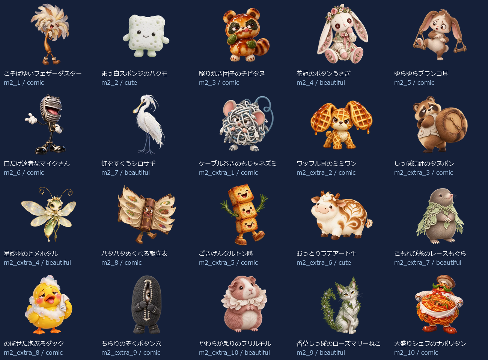
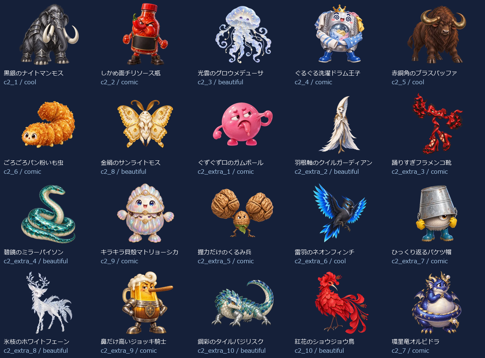
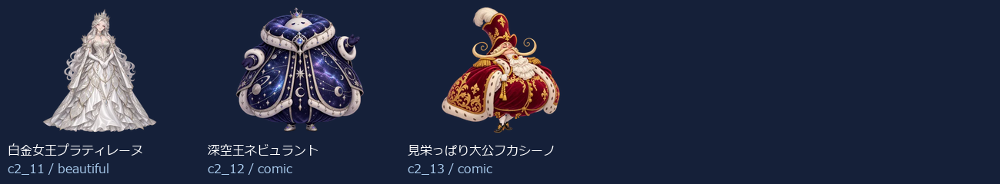

# Eiken1Part2 Level 2：新名称・新画像43体

- 練習20＋バトル23（裏ボス3を含む）＝43キャラ。出題方法で倍に数えていません。
- 新しい名称に合わせてbuilt-in image_genで各キャラを個別制作。以前の4級以降の画像を改名して使っていません。
- 同じprofileから級＋既存IDで名前・タイプ・色・台詞・画像を取得。図鑑・トップ・戦闘・勝利・拡大へ反映。
- 既存ID・HP・登場順・撃破保存キーを維持。5級の名簿と画像は維持。
- 目・表情・体形・素材・画風を分散。設計方向はコミカル24体・かっこいい3体・かわいい2体・きれい14体。分類の件数は笑えることの保証ではなく、実際の見た印象を一覧で確認します。

## 画像と読み込み

- 256px：43枚合計728.5KiB、平均16.9KiB。
- 384px：43枚合計1311.0KiB、平均30.5KiB。
- 1024px：43枚合計6652.5KiB、平均154.7KiB。
- 静止透過WebP、元画像を拡大せず変換。図鑑は遅延取得、戦闘は次の敵の通常画像だけ先読み、高解像度は拡大表示または登場・撃破する現在の1体だけ取得。追加ライブラリなし。
- 旧画像を保全する別URLフォルダを使用し、古い画像キャッシュとの混同を防止。

## 修正一覧

| 区域・順 | ID | 旧名称 | 新名称 | デザインの方向 |
| --- | --- | --- | --- | --- |
| 練習 1 | m2_1 | 遅刻コウモリ | こそばゆいフェザーダスター | コミカル |
| 練習 2 | m2_2 | わすれんぼウルフ | まっ白スポンジのハクモ | かわいい |
| 練習 3 | m2_3 | いじわるフォックス | 照り焼き団子のチビタヌ | コミカル |
| 練習 4 | m2_4 | 居眠りベア | 花冠のボタンうさぎ | きれい |
| 練習 5 | m2_5 | 黒板消しクリーチャー | ゆらゆらブランコ耳 | コミカル |
| 練習 6 | m2_6 | リコーダーへび | 口だけ達者なマイクさん | コミカル |
| 練習 7 | m2_7 | ドッジボールゴーレム | 虹をすくうシロサギ | きれい |
| 練習 8 | m2_extra_1 | 朝礼コウモリ | ケーブル巻きのもじゃネズミ | コミカル |
| 練習 9 | m2_extra_2 | 忘れ物チェックウルフ | ワッフル耳のミミワン | コミカル |
| 練習 10 | m2_extra_3 | 仲直りフォックス | しっぽ時計のタヌポン | コミカル |
| 練習 11 | m2_extra_4 | 目覚ましベア | 星砂羽のヒメホタル | きれい |
| 練習 12 | m2_8 | うわばき隠し | パタパタめくれる献立表 | コミカル |
| 練習 13 | m2_extra_5 | 黒板みがき精 | ごきげんクルトン隊 | コミカル |
| 練習 14 | m2_extra_6 | 音階へび | おっとりラテアート牛 | かわいい |
| 練習 15 | m2_extra_7 | キャッチ練習ロボ | こもれび糸のレースもぐら | きれい |
| 練習 16 | m2_extra_8 | 上ばき番人 | のぼせた泡ぶろダック | コミカル |
| 練習 17 | m2_extra_9 | 静けさトロール | ちらりのぞくボタン穴 | コミカル |
| 練習 18 | m2_extra_10 | テスト前スピリット | やわらかえりのフリルモル | きれい |
| 練習 19 | m2_9 | 騒音トロール | 香草しっぽのローズマリーねこ | きれい |
| 練習 20 | m2_10 | テストの悪魔 | 大盛りシェフのナポリタン | コミカル |
| バトル 1 | c2_1 | ポイズンスライム | 黒銀のナイトマンモス | かっこいい |
| バトル 2 | c2_2 | 氷結のオオカミ | しかめ面チリソース瓶 | コミカル |
| バトル 3 | c2_3 | サンダーバード | 光雲のグロウメデューサ | きれい |
| バトル 4 | c2_4 | ファントムナイト | ぐるぐる洗濯ドラム王子 | コミカル |
| バトル 5 | c2_5 | 古代兵器オメガ | 赤銅角のブラスバッファ | かっこいい |
| バトル 6 | c2_6 | デス・スコーピオン | ごろごろパン粉いも虫 | コミカル |
| バトル 7 | c2_8 | ブリザードミラー | 金絹のサンライトモス | きれい |
| バトル 8 | c2_extra_1 | 毒霧スライム | ぐずぐず口のガムボール | コミカル |
| バトル 9 | c2_extra_2 | 氷牙ウルフ | 羽根軸のクイルガーディアン | きれい |
| バトル 10 | c2_extra_3 | 雷羽バード | 踊りすぎフラメンコ靴 | コミカル |
| バトル 11 | c2_extra_4 | 幻影ナイト | 碧鏡のミラーパイソン | きれい |
| バトル 12 | c2_9 | ナイトメアクロウ | キラキラ貝殻マトリョーシカ | コミカル |
| バトル 13 | c2_extra_5 | 古代ギア兵 | 握力だけのくるみ兵 | コミカル |
| バトル 14 | c2_extra_6 | 砂毒スコーピオン | 雷羽のネオンフィンチ | かっこいい |
| バトル 15 | c2_extra_7 | 氷鏡の番人 | ひっくり返るバケツ帽 | コミカル |
| バトル 16 | c2_extra_8 | 悪夢の羽音 | 氷枝のホワイトフェーン | きれい |
| バトル 17 | c2_extra_9 | 深海の審判官 | 鼻だけ高いジョッキ騎士 | コミカル |
| バトル 18 | c2_extra_10 | 冥府の門衛 | 鋼彩のタイルバジリスク | きれい |
| バトル 19 | c2_10 | 深海のジャッジ | 紅花のショウジョウ鳥 | きれい |
| バトル 20 | c2_7 | 冥王ハーデス | 環星竜オルビドラ | コミカル |
| バトル 21 | c2_11 | 裏冥王レヴナント | 白金女王プラティレーヌ | きれい |
| バトル 22 | c2_12 | 終刻神クロノス | 深空王ネビュラント | コミカル |
| バトル 23 | c2_13 | 真絶望アザゼル | 見栄っぱり大公フカシーノ | コミカル |

## 43体の見本

## 再確認

- `node scripts/test-monster-redesign.mjs`：共通名簿・ID・HP・保存キー、新名称と画像URL・実ファイルの対応。
- `python scripts/export-monster-redesign.py`：元画像ハッシュ、透過、サイズ、四辺、静止画像、拡大せず変換したこと。
- 2026-10-14：ビルドと対応検査が成功。PC幅1366px・スマホ幅390pxで全43名称・画像、戦闘入力・撃破・次の敵・練習を検査済み。図鑑一覧も目視確認。記録：`design/monster-samples/eiken1part2-level2-ui-2026-10-14/report.json`。拡大表示の矢印・キー・模擬スワイプ・記録保持、高DPR・横向き画面を含む7条件も成功（`design/monster-samples/eiken1part2-level2-preview-ui-2026-10-14/report.json`）。実機Pixel Tabletの確認は含みません。
- 耳・羽先・冠先の余白を4体（m2_9、c2_8、c2_extra_2、c2_11）で修正。元画像と旧receiptを保全し、修正プロンプトは `design/monster-samples/eiken1part2-redesign-level2-<ID>-revision.json` に記録。
- [個別制作プロンプト・画像ハッシュ・サイズ・台詞](./eiken1part2-level2.json)。
