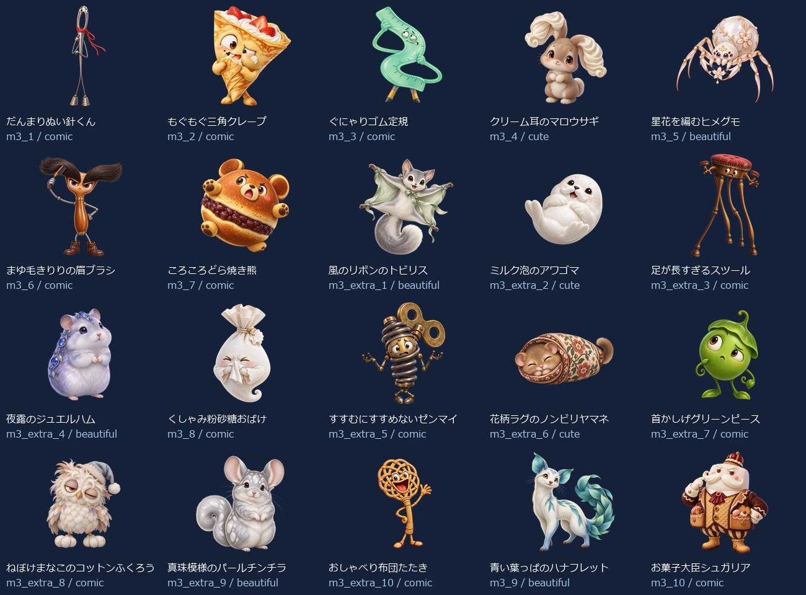
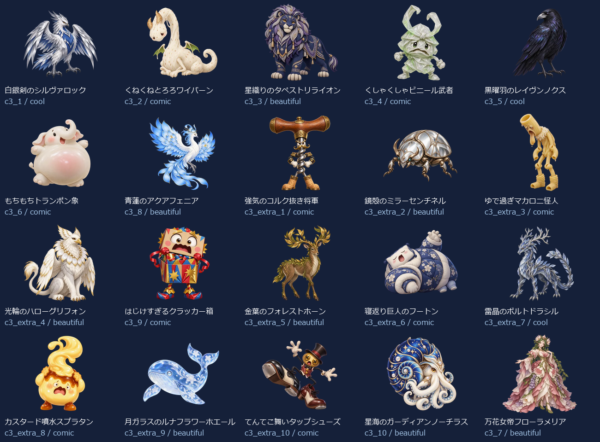
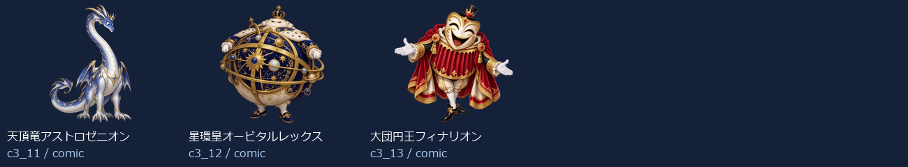

# Eiken1Part2 Level 3：新名称・新画像43体

- 練習20＋バトル23（裏ボス3を含む）＝43キャラ。出題方法で倍に数えていません。
- 新しい名称に合わせてbuilt-in image_genで各キャラを個別制作。以前の4級以降の画像を改名して使っていません。
- 同じprofileから級＋既存IDで名前・タイプ・色・台詞・画像を取得。図鑑・トップ・戦闘・勝利・拡大へ反映。
- 既存ID・HP・登場順・撃破保存キーを維持。5級の名簿と画像は維持。
- 目・表情・体形・素材・画風を分散。設計方向はコミカル24体・かっこいい3体・かわいい3体・きれい13体。分類の件数は笑えることの保証ではなく、実際の見た印象を一覧で確認します。

## 画像と読み込み

- 256px：43枚合計705.2KiB、平均16.4KiB。
- 384px：43枚合計1253.5KiB、平均29.2KiB。
- 1024px：43枚合計6283.6KiB、平均146.1KiB。
- 静止透過WebP、元画像を拡大せず変換。図鑑は遅延取得、戦闘は次の敵の通常画像だけ先読み、高解像度は拡大表示または登場・撃破する現在の1体だけ取得。追加ライブラリなし。
- 旧画像を保全する別URLフォルダを使用し、古い画像キャッシュとの混同を防止。

## 修正一覧

| 区域・順 | ID | 旧名称 | 新名称 | デザインの方向 |
| --- | --- | --- | --- | --- |
| 練習 1 | m3_1 | 言い訳ゴースト | だんまりぬい針くん | コミカル |
| 練習 2 | m3_2 | よそみロボ | もぐもぐ三角クレープ | コミカル |
| 練習 3 | m3_3 | 夜更かしフクロウ | ぐにゃりゴム定規 | コミカル |
| 練習 4 | m3_4 | 廊下ダッシュチーター | クリーム耳のマロウサギ | かわいい |
| 練習 5 | m3_5 | なまけゴーレム | 星花を編むヒメグモ | きれい |
| 練習 6 | m3_6 | 偏食モンスター | まゆ毛きりりの眉ブラシ | コミカル |
| 練習 7 | m3_7 | 迷路マンション | ころころどら焼き熊 | コミカル |
| 練習 8 | m3_extra_1 | 正直ゴースト | 風のリボンのトビリス | きれい |
| 練習 9 | m3_extra_2 | 集中ロボ改 | ミルク泡のアワゴマ | かわいい |
| 練習 10 | m3_extra_3 | 早寝フクロウ | 足が長すぎるスツール | コミカル |
| 練習 11 | m3_extra_4 | 廊下ストッパー | 夜露のジュエルハム | きれい |
| 練習 12 | m3_8 | 雷おやじ | くしゃみ粉砂糖おばけ | コミカル |
| 練習 13 | m3_extra_5 | 運動ゴーレム | すすむにすすめないゼンマイ | コミカル |
| 練習 14 | m3_extra_6 | 野菜スライム | 花柄ラグのノンビリヤマネ | かわいい |
| 練習 15 | m3_extra_7 | 出口案内ミミック | 首かしげグリーンピース | コミカル |
| 練習 16 | m3_extra_8 | 雷雲ゴースト | ねぼけまなこのコットンふくろう | コミカル |
| 練習 17 | m3_extra_9 | 宿題衛星コア | 真珠模様のパールチンチラ | きれい |
| 練習 18 | m3_extra_10 | 提出日ガーディアン | おしゃべり布団たたき | コミカル |
| 練習 19 | m3_9 | 宿題ブラックホール | 青い葉っぱのハナフレット | きれい |
| 練習 20 | m3_10 | 夏休みの宿題王 | お菓子大臣シュガリア | コミカル |
| バトル 1 | c3_1 | カオススライム | 白銀剣のシルヴァロック | かっこいい |
| バトル 2 | c3_2 | キメラビースト | くねくねとろろワイバーン | コミカル |
| バトル 3 | c3_3 | ヴォイドウィング | 星織りのタペストリライオン | きれい |
| バトル 4 | c3_4 | スペクターロード | くしゃくしゃビニール武者 | コミカル |
| バトル 5 | c3_5 | 機神タイタン | 黒曜羽のレイヴンノクス | かっこいい |
| バトル 6 | c3_6 | アビス・ウォーカー | もちもちトランポン象 | コミカル |
| バトル 7 | c3_8 | 断罪のセラフ | 青蓮のアクアフェニア | きれい |
| バトル 8 | c3_extra_1 | 混沌スライム改 | 強気のコルク抜き将軍 | コミカル |
| バトル 9 | c3_extra_2 | 金角キメラ | 鏡殻のミラーセンチネル | きれい |
| バトル 10 | c3_extra_3 | 夜空ウィング | ゆで過ぎマカロニ怪人 | コミカル |
| バトル 11 | c3_extra_4 | 白影ロード | 光輪のハローグリフォン | きれい |
| バトル 12 | c3_9 | 虚無のコロッサス | はじけすぎるクラッカー箱 | コミカル |
| バトル 13 | c3_extra_5 | 機神ガード | 金葉のフォレストホーン | きれい |
| バトル 14 | c3_extra_6 | 深淵ウォーカー改 | 寝返り巨人のフートン | コミカル |
| バトル 15 | c3_extra_7 | 裁きの羽 | 雷晶のボルトドラシル | かっこいい |
| バトル 16 | c3_extra_8 | 虚無巨像の影 | カスタード噴水スプラタン | コミカル |
| バトル 17 | c3_extra_9 | 深紅キマイラ改 | 月ガラスのルナフラワーホエール | きれい |
| バトル 18 | c3_extra_10 | 終焉門の番人 | てんてこ舞いタップシューズ | コミカル |
| バトル 19 | c3_10 | 深紅のキマイラ | 星海のガーディアンノーチラス | きれい |
| バトル 20 | c3_7 | 終焉のドラゴン | 万花女帝フローラメリア | きれい |
| バトル 21 | c3_11 | 裏終焉ネビュラス | 天頂竜アストロゼニオン | コミカル |
| バトル 22 | c3_12 | 深黒皇ディザスター | 星環皇オービタルレックス | コミカル |
| バトル 23 | c3_13 | 真終王アポカリプス | 大団円王フィナリオン | コミカル |

## 43体の見本

## 再確認

- `node scripts/test-monster-redesign.mjs`：共通名簿・ID・HP・保存キー、新名称と画像URL・実ファイルの対応。
- `python scripts/export-monster-redesign.py`：元画像ハッシュ、透過、サイズ、四辺、静止画像、拡大せず変換したこと。
- 上記の全profile検査・画像書き出し検査、およびビルドは成功しました。全43体の元画像・見本を目視確認し、布団たたきの先端と鳳凰の羽先の余白2体を再制作しています。旧原画と修正履歴も保存しています。
- PC幅1366px・スマホ幅390pxで全43画像、戦闘・撃破・次の敵・練習を確認しました。記録：`design/monster-samples/eiken1part2-level3-ui-2026-10-14/report.json`。
- 拡大表示は本LevelのPC・スマホ、英会話のPC・スマホ、英検5級の高解像度PC・スマホ・横向きの7条件で確認しました。矢印・キー・スワイプ、画像解像度、保存された進捗の維持を検査しています。記録：`design/monster-samples/eiken1part2-level3-preview-ui-2026-10-14/report.json`。
- 通常384pxは合計1,283,576bytes（平均29.2KiB）、拡大1024pxは合計6,434,418bytes（平均146.1KiB）。初期図鑑取得はPC28画像・スマホ8画像で、戦闘時は現在の敵と次の敵の必要画像だけを取得することを確認しました。実機Pixel Tabletの確認は含みません。
- 制作・登録はローカル実装済みです。追加画像のコミット・プッシュ・公開反映は未実施です。
- [個別制作プロンプト・画像ハッシュ・サイズ・台詞](./eiken1part2-level3.json)。
