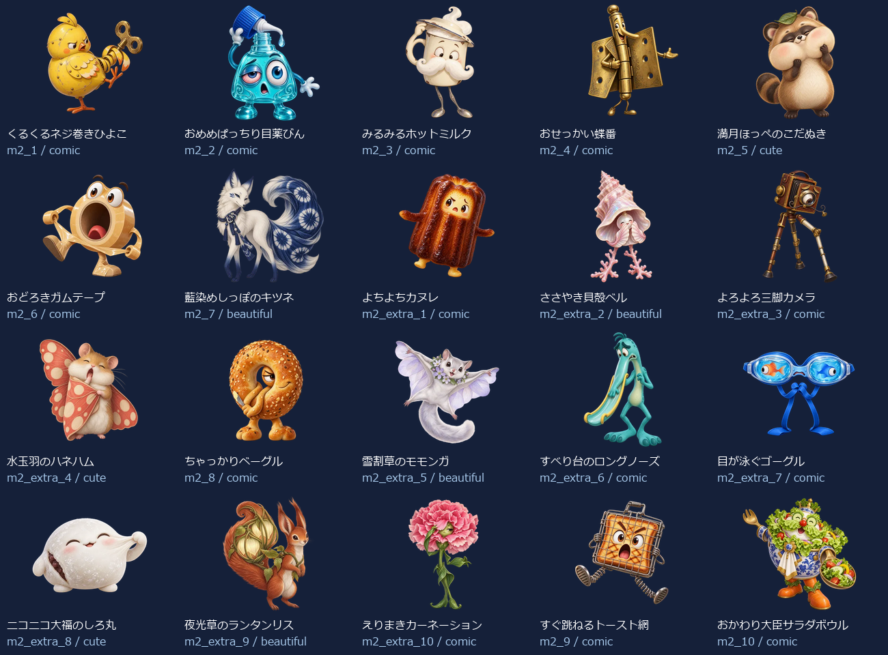
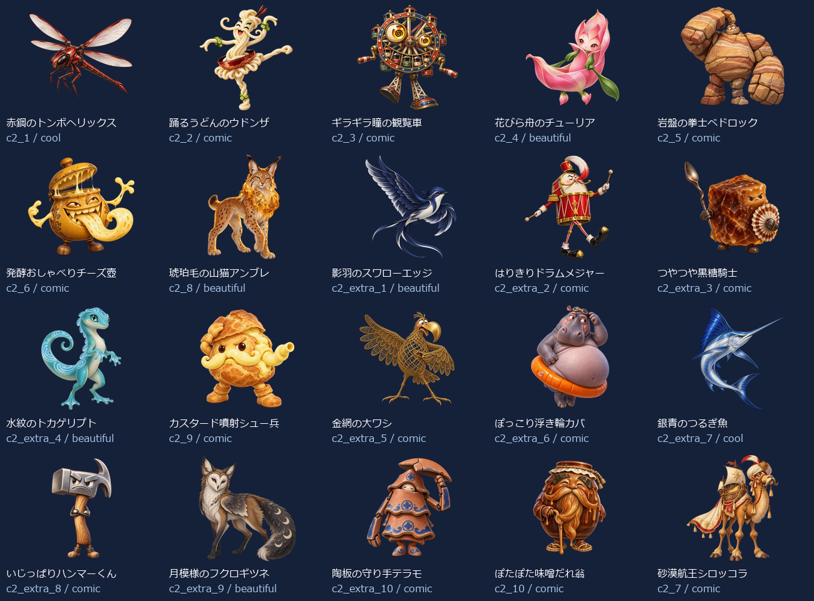
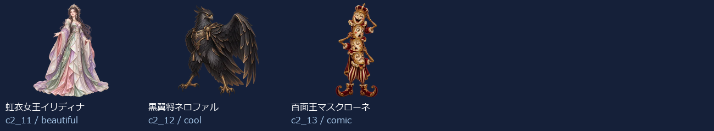

# Eiken2 Level 2：新名称・新画像43体（2026-10-13）

- 練習20＋バトル23（裏ボス3を含む）＝43キャラ。出題方法で倍に数えていません。
- 新しい名称に合わせてbuilt-in image_genで各キャラを個別制作。以前の4級以降の画像を改名して使っていません。
- 同じprofileから級＋既存IDで名前・タイプ・色・台詞・画像を取得。図鑑・トップ・戦闘・勝利・拡大へ反映。
- 既存ID・HP・登場順・撃破保存キーを維持。5級の名簿と画像は維持。
- 目・表情・体形・素材・画風を分散。設計方向はコミカル27体・かっこいい3体・かわいい3体・きれい10体。分類の件数は笑えることの保証ではなく、実際の見た印象を一覧で確認します。

## 画像と読み込み

- 256px：43枚合計736.2KiB、平均17.1KiB。
- 384px：43枚合計1322.2KiB、平均30.7KiB。
- 1024px：43枚合計6761.8KiB、平均157.3KiB。
- 静止透過WebP、元画像を拡大せず変換。図鑑は遅延取得、戦闘は次の敵の通常画像だけ先読み、高解像度は拡大表示または登場・撃破する現在の1体だけ取得。追加ライブラリなし。
- 旧画像を保全する別URLフォルダを使用し、古い画像キャッシュとの混同を防止。

## 修正一覧

| 区域・順 | ID | 旧名称 | 新名称 | デザインの方向 |
| --- | --- | --- | --- | --- |
| 練習 1 | m2_1 | 遅刻コウモリ | くるくるネジ巻きひよこ | コミカル |
| 練習 2 | m2_2 | わすれんぼウルフ | おめめぱっちり目薬びん | コミカル |
| 練習 3 | m2_3 | いじわるフォックス | みるみるホットミルク | コミカル |
| 練習 4 | m2_4 | 居眠りベア | おせっかい蝶番 | コミカル |
| 練習 5 | m2_5 | 黒板消しクリーチャー | 満月ほっぺのこだぬき | かわいい |
| 練習 6 | m2_6 | リコーダーへび | おどろきガムテープ | コミカル |
| 練習 7 | m2_7 | ドッジボールゴーレム | 藍染めしっぽのキツネ | きれい |
| 練習 8 | m2_extra_1 | 朝礼コウモリ | よちよちカヌレ | コミカル |
| 練習 9 | m2_extra_2 | 忘れ物チェックウルフ | ささやき貝殻ベル | きれい |
| 練習 10 | m2_extra_3 | 仲直りフォックス | よろよろ三脚カメラ | コミカル |
| 練習 11 | m2_extra_4 | 目覚ましベア | 水玉羽のハネハム | かわいい |
| 練習 12 | m2_8 | うわばき隠し | ちゃっかりベーグル | コミカル |
| 練習 13 | m2_extra_5 | 黒板みがき精 | 雪割草のモモンガ | きれい |
| 練習 14 | m2_extra_6 | 音階へび | すべり台のロングノーズ | コミカル |
| 練習 15 | m2_extra_7 | キャッチ練習ロボ | 目が泳ぐゴーグル | コミカル |
| 練習 16 | m2_extra_8 | 上ばき番人 | ニコニコ大福のしろ丸 | かわいい |
| 練習 17 | m2_extra_9 | 静けさトロール | 夜光草のランタンリス | きれい |
| 練習 18 | m2_extra_10 | テスト前スピリット | えりまきカーネーション | コミカル |
| 練習 19 | m2_9 | 騒音トロール | すぐ跳ねるトースト網 | コミカル |
| 練習 20 | m2_10 | テストの悪魔 | おかわり大臣サラダボウル | コミカル |
| バトル 1 | c2_1 | ポイズンスライム | 赤鋼のトンボヘリックス | かっこいい |
| バトル 2 | c2_2 | 氷結のオオカミ | 踊るうどんのウドンザ | コミカル |
| バトル 3 | c2_3 | サンダーバード | ギラギラ瞳の観覧車 | コミカル |
| バトル 4 | c2_4 | ファントムナイト | 花びら舟のチューリア | きれい |
| バトル 5 | c2_5 | 古代兵器オメガ | 岩盤の拳士ベドロック | コミカル |
| バトル 6 | c2_6 | デス・スコーピオン | 発酵おしゃべりチーズ壺 | コミカル |
| バトル 7 | c2_8 | ブリザードミラー | 琥珀毛の山猫アンブレ | きれい |
| バトル 8 | c2_extra_1 | 毒霧スライム | 影羽のスワローエッジ | きれい |
| バトル 9 | c2_extra_2 | 氷牙ウルフ | はりきりドラムメジャー | コミカル |
| バトル 10 | c2_extra_3 | 雷羽バード | つやつや黒糖騎士 | コミカル |
| バトル 11 | c2_extra_4 | 幻影ナイト | 水紋のトカゲリプト | きれい |
| バトル 12 | c2_9 | ナイトメアクロウ | カスタード噴射シュー兵 | コミカル |
| バトル 13 | c2_extra_5 | 古代ギア兵 | 金網の大ワシ | コミカル |
| バトル 14 | c2_extra_6 | 砂毒スコーピオン | ぽっこり浮き輪カバ | コミカル |
| バトル 15 | c2_extra_7 | 氷鏡の番人 | 銀青のつるぎ魚 | かっこいい |
| バトル 16 | c2_extra_8 | 悪夢の羽音 | いじっぱりハンマーくん | コミカル |
| バトル 17 | c2_extra_9 | 深海の審判官 | 月模様のフクロギツネ | きれい |
| バトル 18 | c2_extra_10 | 冥府の門衛 | 陶板の守り手テラモ | コミカル |
| バトル 19 | c2_10 | 深海のジャッジ | ぽたぽた味噌だれ翁 | コミカル |
| バトル 20 | c2_7 | 冥王ハーデス | 砂漠航王シロッコラ | コミカル |
| バトル 21 | c2_11 | 裏冥王レヴナント | 虹衣女王イリディナ | きれい |
| バトル 22 | c2_12 | 終刻神クロノス | 黒翼将ネロファル | かっこいい |
| バトル 23 | c2_13 | 真絶望アザゼル | 百面王マスクローネ | コミカル |

## 43体の見本

## 再確認

- `node scripts/test-monster-redesign.mjs`：共通名簿・ID・HP・保存キー、新名称と画像URL・実ファイルの対応。
- `python scripts/export-monster-redesign.py`：元画像ハッシュ、透過、サイズ、四辺、静止画像、拡大せず変換したこと。
- 固定したローカルbuildを隔離Chromeで検査。PC幅1366px・スマホ幅390pxの図鑑43体の名称・画像、戦闘入力・クリア・次の敵・練習、遅延取得・横はみ出しなしを確認。実機Pixel Tabletの確認は含みません。
- `npm run build` 成功。既存の大きなJavaScript bundle警告あり。
- 最初の既存ローカルサーバーでは旧表示のため検査失敗。開発サーバーでの試行はファイル更新による再読み込みで中断。固定buildの5189番で上記を再検査し成功。
- [個別制作プロンプト・画像ハッシュ・サイズ・台詞](./eiken2-level2.json)。
