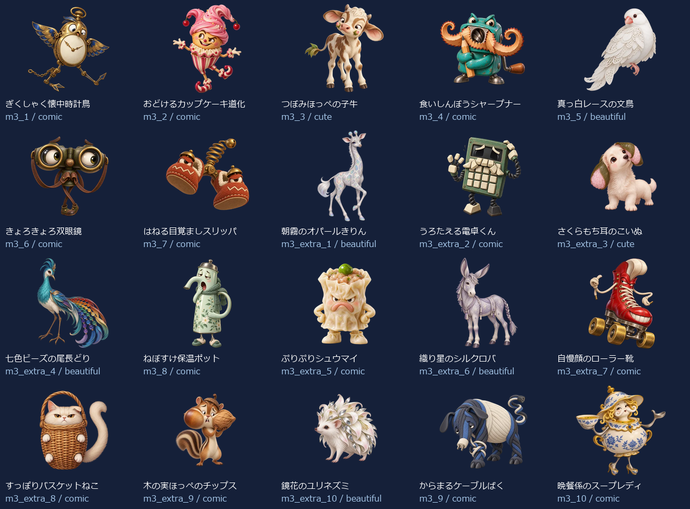
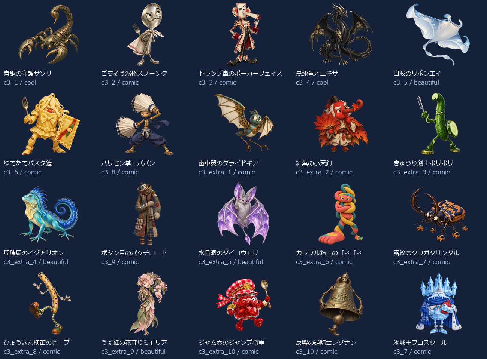
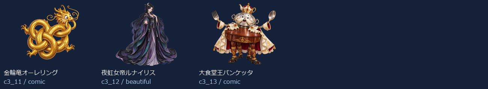

# Eiken2 Level 3：新名称・新画像43体（2026-10-13）

- 練習20＋バトル23（裏ボス3を含む）＝43キャラ。出題方法で倍に数えていません。
- 新しい名称に合わせてbuilt-in image_genで各キャラを個別制作。以前の4級以降の画像を改名して使っていません。
- 同じprofileから級＋既存IDで名前・タイプ・色・台詞・画像を取得。図鑑・トップ・戦闘・勝利・拡大へ反映。
- 既存ID・HP・登場順・撃破保存キーを維持。5級の名簿と画像は維持。
- 目・表情・体形・素材・画風を分散。設計方向はコミカル29体・かっこいい2体・かわいい2体・きれい10体。分類の件数は笑えることの保証ではなく、実際の見た印象を一覧で確認します。

## 画像と読み込み

- 256px：43枚合計738.3KiB、平均17.2KiB。
- 384px：43枚合計1313.3KiB、平均30.5KiB。
- 1024px：43枚合計6520.0KiB、平均151.6KiB。
- 静止透過WebP、元画像を拡大せず変換。図鑑は遅延取得、戦闘は次の敵の通常画像だけ先読み、高解像度は拡大表示または登場・撃破する現在の1体だけ取得。追加ライブラリなし。
- 旧画像を保全する別URLフォルダを使用し、古い画像キャッシュとの混同を防止。

## 修正一覧

| 区域・順 | ID | 旧名称 | 新名称 | デザインの方向 |
| --- | --- | --- | --- | --- |
| 練習 1 | m3_1 | 言い訳ゴースト | ぎくしゃく懐中時計鳥 | コミカル |
| 練習 2 | m3_2 | よそみロボ | おどけるカップケーキ道化 | コミカル |
| 練習 3 | m3_3 | 夜更かしフクロウ | つぼみほっぺの子牛 | かわいい |
| 練習 4 | m3_4 | 廊下ダッシュチーター | 食いしんぼうシャープナー | コミカル |
| 練習 5 | m3_5 | なまけゴーレム | 真っ白レースの文鳥 | きれい |
| 練習 6 | m3_6 | 偏食モンスター | きょろきょろ双眼鏡 | コミカル |
| 練習 7 | m3_7 | 迷路マンション | はねる目覚ましスリッパ | コミカル |
| 練習 8 | m3_extra_1 | 正直ゴースト | 朝霧のオパールきりん | きれい |
| 練習 9 | m3_extra_2 | 集中ロボ改 | うろたえる電卓くん | コミカル |
| 練習 10 | m3_extra_3 | 早寝フクロウ | さくらもち耳のこいぬ | かわいい |
| 練習 11 | m3_extra_4 | 廊下ストッパー | 七色ビーズの尾長どり | きれい |
| 練習 12 | m3_8 | 雷おやじ | ねぼすけ保温ポット | コミカル |
| 練習 13 | m3_extra_5 | 運動ゴーレム | ぷりぷりシュウマイ | コミカル |
| 練習 14 | m3_extra_6 | 野菜スライム | 織り星のシルクロバ | きれい |
| 練習 15 | m3_extra_7 | 出口案内ミミック | 自慢顔のローラー靴 | コミカル |
| 練習 16 | m3_extra_8 | 雷雲ゴースト | すっぽりバスケットねこ | コミカル |
| 練習 17 | m3_extra_9 | 宿題衛星コア | 木の実ほっぺのチップス | コミカル |
| 練習 18 | m3_extra_10 | 提出日ガーディアン | 鏡花のユリネズミ | きれい |
| 練習 19 | m3_9 | 宿題ブラックホール | からまるケーブルばく | コミカル |
| 練習 20 | m3_10 | 夏休みの宿題王 | 晩餐係のスープレディ | コミカル |
| バトル 1 | c3_1 | カオススライム | 青銅の守護サソリ | かっこいい |
| バトル 2 | c3_2 | キメラビースト | ごちそう泥棒スプーンク | コミカル |
| バトル 3 | c3_3 | ヴォイドウィング | トランプ鼻のポーカーフェイス | コミカル |
| バトル 4 | c3_4 | スペクターロード | 黒漆竜オニキサ | かっこいい |
| バトル 5 | c3_5 | 機神タイタン | 白波のリボンエイ | きれい |
| バトル 6 | c3_6 | アビス・ウォーカー | ゆでたてパスタ鎧 | コミカル |
| バトル 7 | c3_8 | 断罪のセラフ | ハリセン拳士パパン | コミカル |
| バトル 8 | c3_extra_1 | 混沌スライム改 | 歯車翼のグライドギア | コミカル |
| バトル 9 | c3_extra_2 | 金角キメラ | 紅葉の小天狗 | コミカル |
| バトル 10 | c3_extra_3 | 夜空ウィング | きゅうり剣士ポリポリ | コミカル |
| バトル 11 | c3_extra_4 | 白影ロード | 瑠璃尾のイグアリオン | きれい |
| バトル 12 | c3_9 | 虚無のコロッサス | ボタン目のパッチロード | コミカル |
| バトル 13 | c3_extra_5 | 機神ガード | 水晶洞のダイコウモリ | きれい |
| バトル 14 | c3_extra_6 | 深淵ウォーカー改 | カラフル粘土のゴネゴネ | コミカル |
| バトル 15 | c3_extra_7 | 裁きの羽 | 雷紋のクワガタサンダル | コミカル |
| バトル 16 | c3_extra_8 | 虚無巨像の影 | ひょうきん横笛のピープ | コミカル |
| バトル 17 | c3_extra_9 | 深紅キマイラ改 | うす紅の花守りミモリア | きれい |
| バトル 18 | c3_extra_10 | 終焉門の番人 | ジャム壺のジャンプ将軍 | コミカル |
| バトル 19 | c3_10 | 深紅のキマイラ | 反響の鐘騎士レゾナン | コミカル |
| バトル 20 | c3_7 | 終焉のドラゴン | 氷城王フロスタール | コミカル |
| バトル 21 | c3_11 | 裏終焉ネビュラス | 金輪竜オーレリング | コミカル |
| バトル 22 | c3_12 | 深黒皇ディザスター | 夜虹女帝ルナイリス | きれい |
| バトル 23 | c3_13 | 真終王アポカリプス | 大食堂王バンケッタ | コミカル |

## 43体の見本

## 再確認

- `node scripts/test-monster-redesign.mjs`：共通名簿・ID・HP・保存キー、新名称と画像URL・実ファイルの対応。
- `python scripts/export-monster-redesign.py`：元画像ハッシュ、透過、サイズ、四辺、静止画像、拡大せず変換したこと。
- UI検査：PC幅1366px・スマホ幅390pxで43体の図鑑画像と名称、戦闘入力、撃破、次の敵、練習を確認。拡大表示・矢印・模擬スワイプ・高DPRを含む7条件も通過。実機Pixel Tabletの確認は含みません。記録：design/monster-samples/eiken2-level3-ui-2026-10-13 および eiken2-level3-preview-ui-2026-10-13。
- npm run build 成功。既存の大きなJSチャンク警告あり。プレビュー検査の専用Chromeは終了済みですが、終了応答のみタイムアウトの記録あり（検査本体は全条件PASS）。
- [個別制作プロンプト・画像ハッシュ・サイズ・台詞](./eiken2-level3.json)。

- ジャム壺のジャンプ将軍：初回画像の端の欠けを検出し、余白を広げて再制作。修正後43体すべての四辺・透過・元画像ハッシュ検査に通過。
