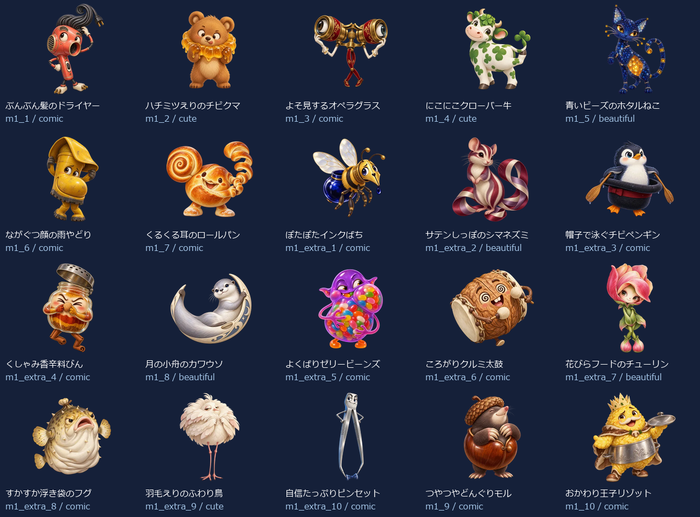
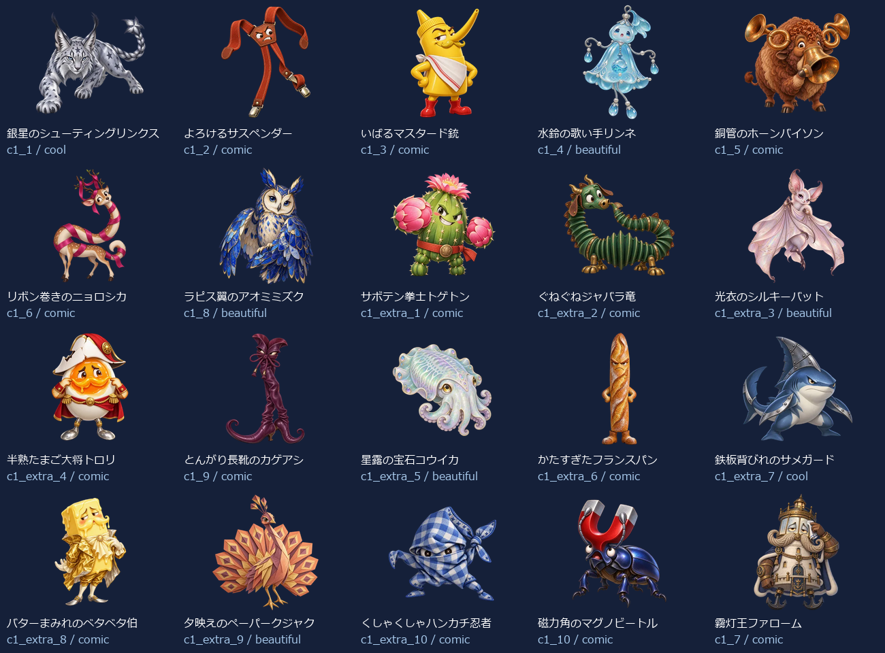
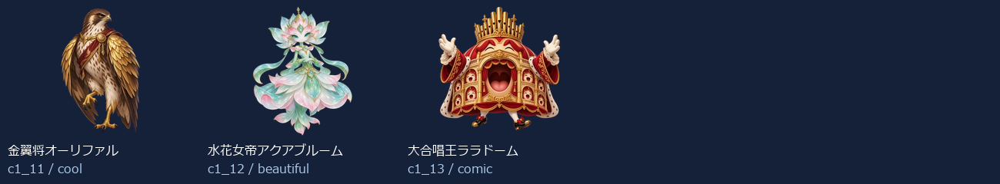

# EikenPre1Part2 Level 1：新名称・新画像43体（2026-10-13）

- 練習20＋バトル23（裏ボス3を含む）＝43キャラ。出題方法で倍に数えていません。
- 新しい名称に合わせてbuilt-in image_genで各キャラを個別制作。以前の4級以降の画像を改名して使っていません。
- 同じprofileから級＋既存IDで名前・タイプ・色・台詞・画像を取得。図鑑・トップ・戦闘・勝利・拡大へ反映。
- 既存ID・HP・登場順・撃破保存キーを維持。5級の名簿と画像は維持。
- 目・表情・体形・素材・画風を分散。設計方向はコミカル27体・かっこいい3体・かわいい3体・きれい10体。分類の件数は笑えることの保証ではなく、実際の見た印象を一覧で確認します。

## 画像と読み込み

- 256px：43枚合計683.9KiB、平均15.9KiB。
- 384px：43枚合計1209.1KiB、平均28.1KiB。
- 1024px：43枚合計6158.3KiB、平均143.2KiB。
- 静止透過WebP、元画像を拡大せず変換。図鑑は遅延取得、戦闘は次の敵の通常画像だけ先読み、高解像度は拡大表示または登場・撃破する現在の1体だけ取得。追加ライブラリなし。
- 旧画像を保全する別URLフォルダを使用し、古い画像キャッシュとの混同を防止。

## 修正一覧

| 区域・順 | ID | 旧名称 | 新名称 | デザインの方向 |
| --- | --- | --- | --- | --- |
| 練習 1 | m1_1 | 朝ねぼうベルクロック | ぶんぶん髪のドライヤー | コミカル |
| 練習 2 | m1_2 | ちらかしノートミミック | ハチミツえりのチビクマ | かわいい |
| 練習 3 | m1_3 | おしゃべりラッパバード | よそ見するオペラグラス | コミカル |
| 練習 4 | m1_4 | つまみぐいスナックオーク | にこにこクローバー牛 | かわいい |
| 練習 5 | m1_5 | らくがきスターゴースト | 青いビーズのホタルねこ | きれい |
| 練習 6 | m1_6 | まいごの消しゴムナイト | ながぐつ顔の雨やどり | コミカル |
| 練習 7 | m1_7 | そうじサボりダストマスク | くるくる耳のロールパン | コミカル |
| 練習 8 | m1_extra_1 | 朝チャイムスライム | ぽたぽたインクばち | コミカル |
| 練習 9 | m1_extra_2 | プリントつむじバード | サテンしっぽのシマネズミ | きれい |
| 練習 10 | m1_extra_3 | えんぴつ番人ゴーレム | 帽子で泳ぐチビペンギン | コミカル |
| 練習 11 | m1_extra_4 | 給食列ならびオーク | くしゃみ香辛料びん | コミカル |
| 練習 12 | m1_8 | 給食おかわりキング | 月の小舟のカワウソ | きれい |
| 練習 13 | m1_extra_5 | 音読こだまゴースト | よくばりゼリービーンズ | コミカル |
| 練習 14 | m1_extra_6 | 時間割ロボ | ころがりクルミ太鼓 | コミカル |
| 練習 15 | m1_extra_7 | ノート整理スライム | 花びらフードのチューリン | きれい |
| 練習 16 | m1_extra_8 | 小テストフクロウ | すかすか浮き袋のフグ | コミカル |
| 練習 17 | m1_extra_9 | しおり守りミミック | 羽毛えりのふわり鳥 | かわいい |
| 練習 18 | m1_extra_10 | 集中ほのおビースト | 自信たっぷりピンセット | コミカル |
| 練習 19 | m1_9 | としょかん禁書ミミック | つやつやどんぐりモル | コミカル |
| 練習 20 | m1_10 | ゲーム沼ドラゴン | おかわり王子リゾット | コミカル |
| バトル 1 | c1_1 | 影ぬいインクコア | 銀星のシューティングリンクス | かっこいい |
| バトル 2 | c1_2 | 炎門のケルベロス | よろけるサスペンダー | コミカル |
| バトル 3 | c1_3 | 嵐譜のウイングメイジ | いばるマスタード銃 | コミカル |
| バトル 4 | c1_4 | 呪面ファントム | 水鈴の歌い手リンネ | きれい |
| バトル 5 | c1_5 | 鉄壁プロトガード | 銅管のホーンバイソン | コミカル |
| バトル 6 | c1_6 | 地鳴りルーンゴーレム | リボン巻きのニョロシカ | コミカル |
| バトル 7 | c1_8 | 紅牙ブラッドファング | ラピス翼のアオミミズク | きれい |
| バトル 8 | c1_extra_1 | 黒インクスライム改 | サボテン拳士トゲトン | コミカル |
| バトル 9 | c1_extra_2 | 火花の番犬 | ぐねぐねジャバラ竜 | コミカル |
| バトル 10 | c1_extra_3 | 風読みウィング | 光衣のシルキーバット | きれい |
| バトル 11 | c1_extra_4 | 仮面の影法師 | 半熟たまご大将トロリ | コミカル |
| バトル 12 | c1_9 | 奈落ランタンレイス | とんがり長靴のカゲアシ | コミカル |
| バトル 13 | c1_extra_5 | 鉄壁ガード改 | 星露の宝石コウイカ | きれい |
| バトル 14 | c1_extra_6 | 石文ルーン像 | かたすぎたフランスパン | コミカル |
| バトル 15 | c1_extra_7 | 紅牙の追跡者 | 鉄板背びれのサメガード | かっこいい |
| バトル 16 | c1_extra_8 | 奈落の灯火 | バターまみれのベタベタ伯 | コミカル |
| バトル 17 | c1_extra_9 | 獄炎の照準手 | 夕映えのペーパークジャク | きれい |
| バトル 18 | c1_extra_10 | 魔門の門番 | くしゃくしゃハンカチ忍者 | コミカル |
| バトル 19 | c1_10 | 獄炎バリスタ・アイ | 磁力角のマグノビートル | コミカル |
| バトル 20 | c1_7 | 魔王ドラゴニス | 霧灯王ファローム | コミカル |
| バトル 21 | c1_11 | 裏魔竜ヴォイド | 金翼将オーリファル | かっこいい |
| バトル 22 | c1_12 | 深淵王ネメシス | 水花女帝アクアブルーム | きれい |
| バトル 23 | c1_13 | 真冥皇アポカリス | 大合唱王ララドーム | コミカル |

## 43体の見本

## 再確認

- `node scripts/test-monster-redesign.mjs`：共通名簿・ID・HP・保存キー、新名称と画像URL・実ファイルの対応。
- `python scripts/export-monster-redesign.py`：元画像ハッシュ、透過、サイズ、四辺、静止画像、拡大せず変換したこと。
- PC幅1366px・スマホ幅390pxで全43体の名称と画像、戦闘入力・撃破・次の敵・練習を確認済み。図鑑の初期取得はそれぞれ32枚・10枚で、残りはスクロール後に取得。バトルは現在の敵と次の敵の画像取得を確認。英会話のSVG表示も維持。`design/monster-samples/eikenpre1part2-level1-ui-2026-10-13/`に記録。
- ビルドと`test-monster-redesign.mjs`を通過。拡大表示の開閉・切り替えをPC幅1366px・スマホ幅390pxで確認済み。英会話と英検5級の拡大表示も含む7条件を通過し、`design/monster-samples/eikenpre1part2-level1-preview-ui-2026-10-13/`に記録。実機Pixel Tabletの体感速度・操作は未確認。
- [個別制作プロンプト・画像ハッシュ・サイズ・台詞](./eikenpre1part2-level1.json)。
