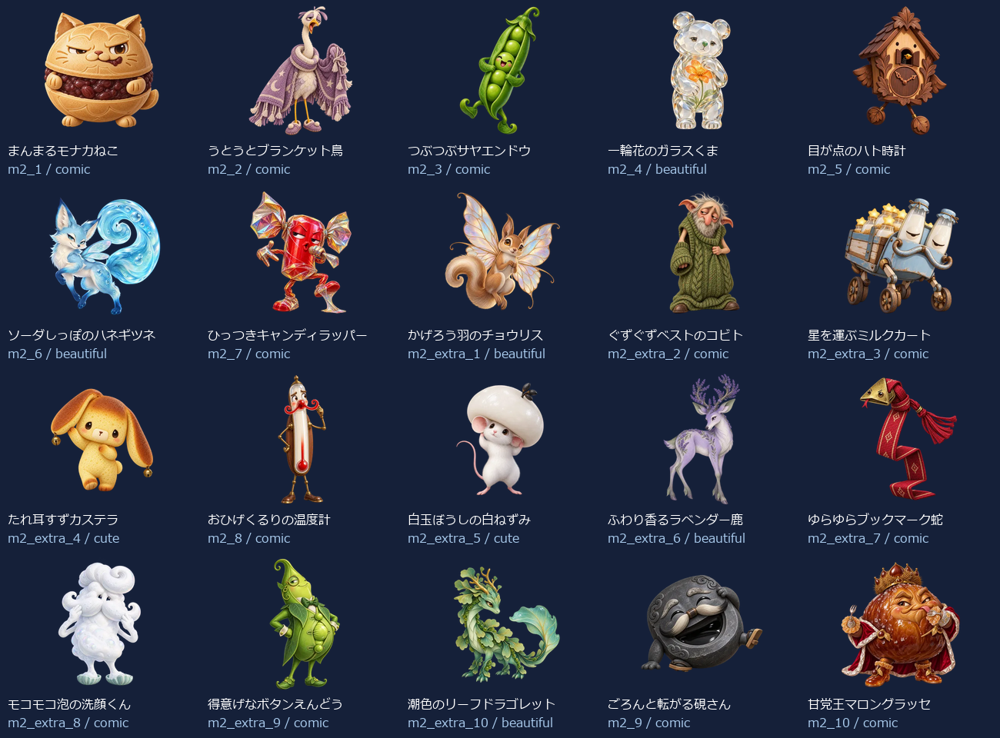
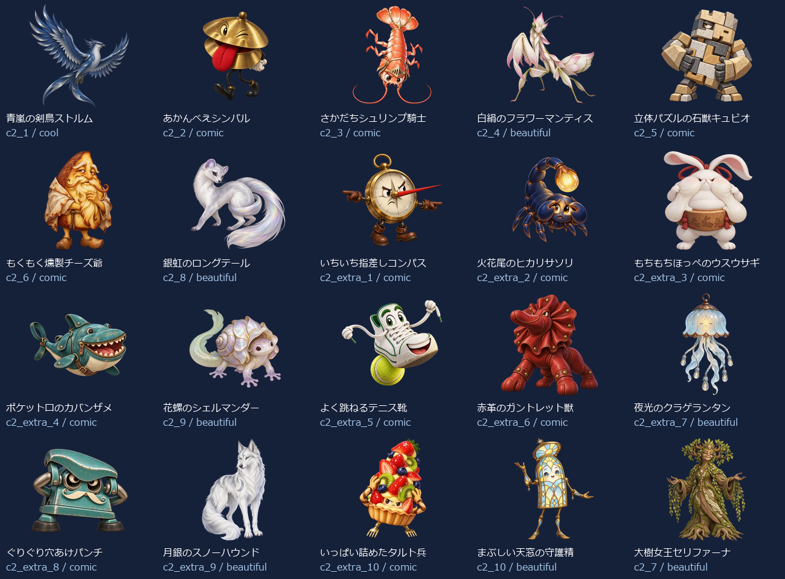
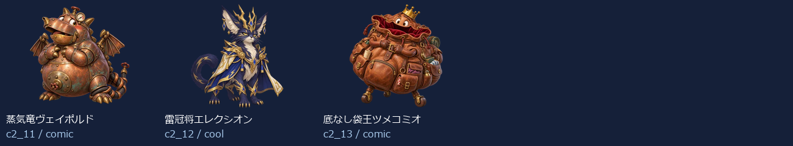

# EikenPre1Part2 Level 2：新名称・新画像43体（2026-10-14）

- 練習20＋バトル23（裏ボス3を含む）＝43キャラ。出題方法で倍に数えていません。
- 新しい名称に合わせてbuilt-in image_genで各キャラを個別制作。以前の4級以降の画像を改名して使っていません。
- 同じprofileから級＋既存IDで名前・タイプ・色・台詞・画像を取得。図鑑・トップ・戦闘・勝利・拡大へ反映。
- 既存ID・HP・登場順・撃破保存キーを維持。5級の名簿と画像は維持。
- 目・表情・体形・素材・画風を分散。設計方向はコミカル27体・かっこいい2体・かわいい2体・きれい12体。分類の件数は笑えることの保証ではなく、実際の見た印象を一覧で確認します。

## 画像と読み込み

- 256px：43枚合計722.8KiB、平均16.8KiB。
- 384px：43枚合計1298.7KiB、平均30.2KiB。
- 1024px：43枚合計6703.2KiB、平均155.9KiB。
- 静止透過WebP、元画像を拡大せず変換。図鑑は遅延取得、戦闘は次の敵の通常画像だけ先読み、高解像度は拡大表示または登場・撃破する現在の1体だけ取得。追加ライブラリなし。
- 旧画像を保全する別URLフォルダを使用し、古い画像キャッシュとの混同を防止。

## 修正一覧

| 区域・順 | ID | 旧名称 | 新名称 | デザインの方向 |
| --- | --- | --- | --- | --- |
| 練習 1 | m2_1 | 遅刻コウモリ | まんまるモナカねこ | コミカル |
| 練習 2 | m2_2 | わすれんぼウルフ | うとうとブランケット鳥 | コミカル |
| 練習 3 | m2_3 | いじわるフォックス | つぶつぶサヤエンドウ | コミカル |
| 練習 4 | m2_4 | 居眠りベア | 一輪花のガラスくま | きれい |
| 練習 5 | m2_5 | 黒板消しクリーチャー | 目が点のハト時計 | コミカル |
| 練習 6 | m2_6 | リコーダーへび | ソーダしっぽのハネギツネ | きれい |
| 練習 7 | m2_7 | ドッジボールゴーレム | ひっつきキャンディラッパー | コミカル |
| 練習 8 | m2_extra_1 | 朝礼コウモリ | かげろう羽のチョウリス | きれい |
| 練習 9 | m2_extra_2 | 忘れ物チェックウルフ | ぐずぐずベストのコビト | コミカル |
| 練習 10 | m2_extra_3 | 仲直りフォックス | 星を運ぶミルクカート | コミカル |
| 練習 11 | m2_extra_4 | 目覚ましベア | たれ耳すずカステラ | かわいい |
| 練習 12 | m2_8 | うわばき隠し | おひげくるりの温度計 | コミカル |
| 練習 13 | m2_extra_5 | 黒板みがき精 | 白玉ぼうしの白ねずみ | かわいい |
| 練習 14 | m2_extra_6 | 音階へび | ふわり香るラベンダー鹿 | きれい |
| 練習 15 | m2_extra_7 | キャッチ練習ロボ | ゆらゆらブックマーク蛇 | コミカル |
| 練習 16 | m2_extra_8 | 上ばき番人 | モコモコ泡の洗顔くん | コミカル |
| 練習 17 | m2_extra_9 | 静けさトロール | 得意げなボタンえんどう | コミカル |
| 練習 18 | m2_extra_10 | テスト前スピリット | 潮色のリーフドラゴレット | きれい |
| 練習 19 | m2_9 | 騒音トロール | ごろんと転がる硯さん | コミカル |
| 練習 20 | m2_10 | テストの悪魔 | 甘党王マロングラッセ | コミカル |
| バトル 1 | c2_1 | ポイズンスライム | 青嵐の剣鳥ストルム | かっこいい |
| バトル 2 | c2_2 | 氷結のオオカミ | あかんべえシンバル | コミカル |
| バトル 3 | c2_3 | サンダーバード | さかだちシュリンプ騎士 | コミカル |
| バトル 4 | c2_4 | ファントムナイト | 白絹のフラワーマンティス | きれい |
| バトル 5 | c2_5 | 古代兵器オメガ | 立体パズルの石獣キュビオ | コミカル |
| バトル 6 | c2_6 | デス・スコーピオン | もくもく燻製チーズ爺 | コミカル |
| バトル 7 | c2_8 | ブリザードミラー | 銀虹のロングテール | きれい |
| バトル 8 | c2_extra_1 | 毒霧スライム | いちいち指差しコンパス | コミカル |
| バトル 9 | c2_extra_2 | 氷牙ウルフ | 火花尾のヒカリサソリ | コミカル |
| バトル 10 | c2_extra_3 | 雷羽バード | もちもちほっぺのウスウサギ | コミカル |
| バトル 11 | c2_extra_4 | 幻影ナイト | ポケット口のカバンザメ | コミカル |
| バトル 12 | c2_9 | ナイトメアクロウ | 花螺のシェルマンダー | きれい |
| バトル 13 | c2_extra_5 | 古代ギア兵 | よく跳ねるテニス靴 | コミカル |
| バトル 14 | c2_extra_6 | 砂毒スコーピオン | 赤革のガントレット獣 | コミカル |
| バトル 15 | c2_extra_7 | 氷鏡の番人 | 夜光のクラゲランタン | きれい |
| バトル 16 | c2_extra_8 | 悪夢の羽音 | ぐりぐり穴あけパンチ | コミカル |
| バトル 17 | c2_extra_9 | 深海の審判官 | 月銀のスノーハウンド | きれい |
| バトル 18 | c2_extra_10 | 冥府の門衛 | いっぱい詰めたタルト兵 | コミカル |
| バトル 19 | c2_10 | 深海のジャッジ | まぶしい天窓の守護精 | きれい |
| バトル 20 | c2_7 | 冥王ハーデス | 大樹女王セリファーナ | きれい |
| バトル 21 | c2_11 | 裏冥王レヴナント | 蒸気竜ヴェイポルド | コミカル |
| バトル 22 | c2_12 | 終刻神クロノス | 雷冠将エレクシオン | かっこいい |
| バトル 23 | c2_13 | 真絶望アザゼル | 底なし袋王ツメコミオ | コミカル |

## 43体の見本

## 再確認

- `node scripts/test-monster-redesign.mjs`：共通名簿・ID・HP・保存キー、新名称と画像URL・実ファイルの対応。
- `python scripts/export-monster-redesign.py`：元画像ハッシュ、透過、サイズ、四辺、静止画像、拡大せず変換したこと。
- 2026-10-14：PC幅1366px・スマホ幅390pxで全43体の図鑑画像と名称、戦闘入力・撃破・次の敵・練習を確認。横はみ出し・ブラウザー実行エラーなし。既存の英会話SVG表示も維持。検証記録は design/monster-samples/eikenpre1part2-level2-ui-2026-10-14/。実機Pixel Tabletの確認は含みません。
- [個別制作プロンプト・画像ハッシュ・サイズ・台詞](./eikenpre1part2-level2.json)。

- 2026-10-14：拡大表示の矢印・キー・模擬スワイプ、モバイル幅、既存5級の高DPR・横画面、英会話SVGの9条件も通過。検証記録は design/monster-samples/eikenpre1part2-level23-preview-2026-10-14/。
