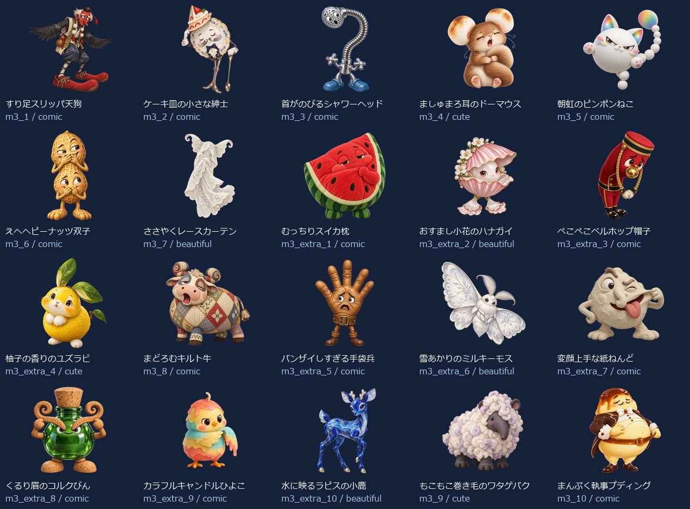
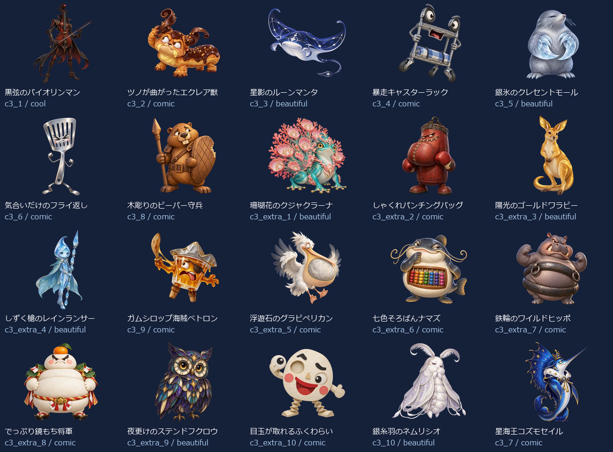
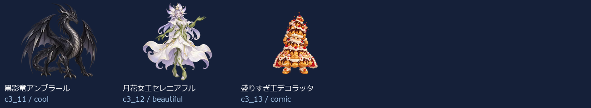

# EikenPre1Part2 Level 3：新名称・新画像43体（2026-10-14）

- 練習20＋バトル23（裏ボス3を含む）＝43キャラ。出題方法で倍に数えていません。
- 新しい名称に合わせてbuilt-in image_genで各キャラを個別制作。以前の4級以降の画像を改名して使っていません。
- 同じprofileから級＋既存IDで名前・タイプ・色・台詞・画像を取得。図鑑・トップ・戦闘・勝利・拡大へ反映。
- 既存ID・HP・登場順・撃破保存キーを維持。5級の名簿と画像は維持。
- 目・表情・体形・素材・画風を分散。設計方向はコミカル26体・かっこいい2体・かわいい3体・きれい12体。分類の件数は笑えることの保証ではなく、実際の見た印象を一覧で確認します。

## 画像と読み込み

- 256px：43枚合計713.0KiB、平均16.6KiB。
- 384px：43枚合計1265.4KiB、平均29.4KiB。
- 1024px：43枚合計6481.1KiB、平均150.7KiB。
- 静止透過WebP、元画像を拡大せず変換。図鑑は遅延取得、戦闘は次の敵の通常画像だけ先読み、高解像度は拡大表示または登場・撃破する現在の1体だけ取得。追加ライブラリなし。
- 旧画像を保全する別URLフォルダを使用し、古い画像キャッシュとの混同を防止。

## 修正一覧

| 区域・順 | ID | 旧名称 | 新名称 | デザインの方向 |
| --- | --- | --- | --- | --- |
| 練習 1 | m3_1 | 言い訳ゴースト | すり足スリッパ天狗 | コミカル |
| 練習 2 | m3_2 | よそみロボ | ケーキ皿の小さな紳士 | コミカル |
| 練習 3 | m3_3 | 夜更かしフクロウ | 首がのびるシャワーヘッド | コミカル |
| 練習 4 | m3_4 | 廊下ダッシュチーター | ましゅまろ耳のドーマウス | かわいい |
| 練習 5 | m3_5 | なまけゴーレム | 朝虹のピンポンねこ | コミカル |
| 練習 6 | m3_6 | 偏食モンスター | えへへピーナッツ双子 | コミカル |
| 練習 7 | m3_7 | 迷路マンション | ささやくレースカーテン | きれい |
| 練習 8 | m3_extra_1 | 正直ゴースト | むっちりスイカ枕 | コミカル |
| 練習 9 | m3_extra_2 | 集中ロボ改 | おすまし小花のハナガイ | きれい |
| 練習 10 | m3_extra_3 | 早寝フクロウ | ぺこぺこベルホップ帽子 | コミカル |
| 練習 11 | m3_extra_4 | 廊下ストッパー | 柚子の香りのユズラビ | かわいい |
| 練習 12 | m3_8 | 雷おやじ | まどろむキルト牛 | コミカル |
| 練習 13 | m3_extra_5 | 運動ゴーレム | バンザイしすぎる手袋兵 | コミカル |
| 練習 14 | m3_extra_6 | 野菜スライム | 雪あかりのミルキーモス | きれい |
| 練習 15 | m3_extra_7 | 出口案内ミミック | 変顔上手な紙ねんど | コミカル |
| 練習 16 | m3_extra_8 | 雷雲ゴースト | くるり眉のコルクびん | コミカル |
| 練習 17 | m3_extra_9 | 宿題衛星コア | カラフルキャンドルひよこ | コミカル |
| 練習 18 | m3_extra_10 | 提出日ガーディアン | 水に映るラピスの小鹿 | きれい |
| 練習 19 | m3_9 | 宿題ブラックホール | もこもこ巻き毛のワタゲバク | かわいい |
| 練習 20 | m3_10 | 夏休みの宿題王 | まんぷく執事プディング | コミカル |
| バトル 1 | c3_1 | カオススライム | 黒弦のバイオリンマン | かっこいい |
| バトル 2 | c3_2 | キメラビースト | ツノが曲がったエクレア獣 | コミカル |
| バトル 3 | c3_3 | ヴォイドウィング | 星影のルーンマンタ | きれい |
| バトル 4 | c3_4 | スペクターロード | 暴走キャスターラック | コミカル |
| バトル 5 | c3_5 | 機神タイタン | 銀氷のクレセントモール | きれい |
| バトル 6 | c3_6 | アビス・ウォーカー | 気合いだけのフライ返し | コミカル |
| バトル 7 | c3_8 | 断罪のセラフ | 木彫りのビーバー守兵 | コミカル |
| バトル 8 | c3_extra_1 | 混沌スライム改 | 珊瑚花のクジャクラーナ | きれい |
| バトル 9 | c3_extra_2 | 金角キメラ | しゃくれパンチングバッグ | コミカル |
| バトル 10 | c3_extra_3 | 夜空ウィング | 陽光のゴールドワラビー | きれい |
| バトル 11 | c3_extra_4 | 白影ロード | しずく槍のレインランサー | きれい |
| バトル 12 | c3_9 | 虚無のコロッサス | ガムシロップ海賊ベトロン | コミカル |
| バトル 13 | c3_extra_5 | 機神ガード | 浮遊石のグラビペリカン | コミカル |
| バトル 14 | c3_extra_6 | 深淵ウォーカー改 | 七色そろばんナマズ | コミカル |
| バトル 15 | c3_extra_7 | 裁きの羽 | 鉄輪のワイルドヒッポ | コミカル |
| バトル 16 | c3_extra_8 | 虚無巨像の影 | でっぷり鏡もち将軍 | コミカル |
| バトル 17 | c3_extra_9 | 深紅キマイラ改 | 夜更けのステンドフクロウ | きれい |
| バトル 18 | c3_extra_10 | 終焉門の番人 | 目玉が取れるふくわらい | コミカル |
| バトル 19 | c3_10 | 深紅のキマイラ | 銀糸羽のネムリシオ | きれい |
| バトル 20 | c3_7 | 終焉のドラゴン | 星海王コズモセイル | コミカル |
| バトル 21 | c3_11 | 裏終焉ネビュラス | 黒影竜アンブラール | かっこいい |
| バトル 22 | c3_12 | 深黒皇ディザスター | 月花女王セレニアフル | きれい |
| バトル 23 | c3_13 | 真終王アポカリプス | 盛りすぎ王デコラッタ | コミカル |

## 43体の見本

## 再確認

- `node scripts/test-monster-redesign.mjs`：共通名簿・ID・HP・保存キー、新名称と画像URL・実ファイルの対応。
- `python scripts/export-monster-redesign.py`：元画像ハッシュ、透過、サイズ、四辺、静止画像、拡大せず変換したこと。
- 2026-10-14：PC幅1366px・スマホ幅390pxで全43体の図鑑画像と名称、戦闘入力・撃破・次の敵・練習を確認。横はみ出し・ブラウザー実行エラーなし。既存の英会話SVG表示も維持。検証記録は design/monster-samples/eikenpre1part2-level3-ui-2026-10-14/。実機Pixel Tabletの確認は含みません。
- [個別制作プロンプト・画像ハッシュ・サイズ・台詞](./eikenpre1part2-level3.json)。

- 2026-10-14：拡大表示の矢印・キー・模擬スワイプ、モバイル幅、既存5級の高DPR・横画面、英会話SVGの9条件も通過。検証記録は design/monster-samples/eikenpre1part2-level23-preview-2026-10-14/。
